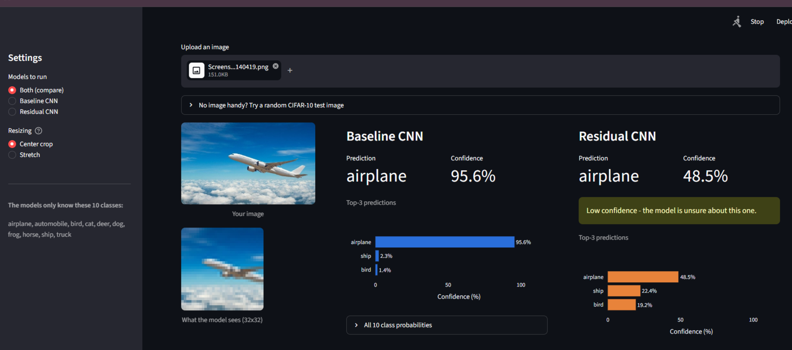

# CIFAR-10 Image Classification with Streamlit

An interactive image-classification app that compares two TensorFlow/Keras CNN models trained on the CIFAR-10 dataset. Upload an image to see the models' predictions, confidence scores, and top-3 classes side by side.

## Streamlit App Preview



*Example: the uploaded airplane image is classified by both models. Confidence scores can differ substantially between models.*

## Models and Results

| Model | Description | Test accuracy |
|---|---|---:|
| Baseline CNN | Convolution, batch normalization, ReLU, pooling, dropout, and dense classification layers | **75.24%** |
| Residual CNN | Convolutional stem with a residual block and identity shortcut | 58.96% |

In this experiment, the baseline CNN performed better. The residual model's result suggests that its architecture and training settings need further investigation; a residual connection alone does not guarantee better accuracy.

## Features

- Upload PNG, JPG, JPEG, WebP, or BMP images.
- Run the saved Baseline CNN, Residual CNN, or both models.
- View predicted class, confidence score, and top-3 predictions.
- Compare predictions side by side and see when the models disagree.
- Preview the image resized to the model's 32 × 32 input size.
- Explore all 10 class probabilities.
- Optionally evaluate models on CIFAR-10 test images when the dataset is available.

## CIFAR-10 Classes

Airplane, automobile, bird, cat, deer, dog, frog, horse, ship, and truck.

## Project Files

```text
Image_classification/
├── app.py
├── cifar_utils.py
├── CIFAR10_Image_Classification.ipynb
├── baseline_cnn.keras
├── residual_cnn.keras
├── requirements.txt
├── README.md
└── screenshots/
    └── streamlit-demo.png
```

## Run Locally

Use a compatible Python version and run these commands in the project folder:

```bash
python -m venv .venv
```

Activate the environment on Windows PowerShell:

```powershell
.venv\Scripts\Activate.ps1
```

Install dependencies and launch Streamlit:

```bash
python -m pip install -r requirements.txt
python -m streamlit run app.py
```

Open `http://localhost:8501` in your browser. The app loads the saved `.keras` models and does not retrain them.

## Preprocessing and Confidence Notes

The models were trained on 32 × 32 RGB images with pixel values scaled to the range 0–1. Uploaded images are converted to RGB and resized according to the selected app setting. Large images can lose visual detail when reduced to 32 × 32.

The model always selects among the 10 CIFAR-10 classes, even if an uploaded image does not belong to one of them. Softmax confidence is a model score and does not guarantee that a prediction is correct.

## Technologies

Python, TensorFlow, Keras, NumPy, Matplotlib, and Streamlit.

## Future Improvements

- Train a deeper residual network for more epochs.
- Tune learning rate, regularization, and batch size.
- Add model calibration and a more robust out-of-distribution warning.
- Track inference latency across different hardware.
